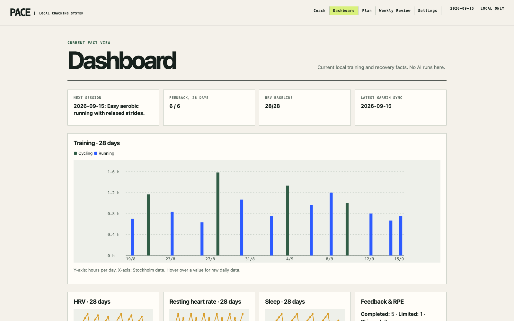

# Pace

**A private, local-first AI coach for running and cycling.**

Pace imports training and recovery data from Garmin Connect, calculates a
reviewable set of facts on your computer, and uses an AI coach for plans,
questions, and weekly reviews only when you ask it to.

> **Status:** early alpha. Pace is useful, but the Garmin integration is
> unofficial and the project has not yet had broad platform testing. The v0.1
> interface and coach output are in English.

## Product preview



This preview uses fully synthetic training and recovery data. No athlete,
Garmin, or OpenAI account data is included. See the
[complete product demo](docs/PRODUCT_DEMO.md) for the active plan, weekly
review, and instructions for running the read-only demo locally.

## Why Pace exists

Most training-plan apps ask you to describe your own fitness. Pace starts with
what you actually did. It separates the system into clear responsibilities:

```text
Garmin Connect
    ↓
local SQLite database
    ↓
deterministic Python facts and validation
    ↓
AI coach proposes and explains
    ↓
you explicitly request or confirm every saved change
```

- **Python owns facts.** Time, distance, frequency, baselines, data quality,
  plan constraints, and validation are calculated in code.
- **You own intent.** You choose sport balance, ambition, availability, races,
  and report how sessions felt.
- **The model owns coaching judgment.** It selects and explains training using
  the supplied evidence. It cannot silently rewrite stored facts or plans.

## What works today

- Guided local setup in the browser
- Garmin login and bounded historical sync
- Running, cycling, HRV, resting-heart-rate, and sleep history
- Athlete context such as illness, pain, travel, and schedule constraints
- Race-aware or general 14-day detailed training plans
- Structured workouts, including intervals and recovery steps
- Session feedback through normal language in the Coach view
- Training dashboard, active plan, and stable weekly review pages
- Personalization from explicit feedback rather than hidden guesswork
- CLI access for diagnostics and reproducible advanced workflows

## Requirements

- macOS (the currently tested platform)
- [uv](https://docs.astral.sh/uv/) for Python and dependencies
- A Garmin Connect account
- Your own OpenAI API key for AI features

Pace currently requires Python 3.14. `uv` can install and manage that Python
version for the project.

On a Mac with Homebrew, install `uv` once:

```bash
brew install uv
```

## Quick start

### Private Pace Light companion

Pace Light is an optional private hosted mirror for viewing current normalized
training facts and the active plan on any device. The local installation stays
canonical and uploads a bounded read-only snapshot; browser visitors must sign
in with ChatGPT. No Garmin/OpenAI credentials, raw payloads, GPS, provider IDs,
private notes, database dumps or AI context are uploaded. Pace Light cannot edit
or synchronize data back to the local application.

### Full Garmin and AI path

```bash
git clone https://github.com/viktoreneqvist-hash/Pace.git
cd Pace
uv sync
uv run pace serve
```

The app opens at `http://127.0.0.1:8765`. It is bound to your own computer,
not published to the internet. Keep the terminal window open while Pace runs.

### Optional private phone access pilot

Pace remains bound to `127.0.0.1`. On a Mac already connected to your private
Tailscale network, `--tailscale` opts into accepting that Mac's validated
MagicDNS hostname and using Secure browser session cookies:

1. Install Tailscale on the Mac and your phone. Sign both into the same
   personal tailnet, enable MagicDNS and HTTPS certificates in the Tailscale
   admin console, and do not invite anyone else to that tailnet for this
   single-user pilot. See Tailscale's [MagicDNS guide](https://tailscale.com/kb/1081/magicdns)
   and [Serve guide](https://tailscale.com/kb/1242/tailscale-serve).
2. In one terminal on the Mac, start Pace:

   ```bash
   uv run pace serve --tailscale --no-browser
   ```

   Pace checks the connected Tailscale device status, prints its HTTPS
   MagicDNS address, continues to listen only on `127.0.0.1`, and records the
   Tailscale owner identity that it will allow.
3. In a second terminal on the Mac, start Tailscale's private HTTPS proxy:

   ```bash
   tailscale serve --https=443 http://127.0.0.1:8765
   ```

4. On the phone, open the HTTPS MagicDNS address printed by Pace. The phone
   must be connected to the same tailnet.
5. Press Ctrl+C in both terminals when finished.

Tailscale Serve is reachable within the tailnet; it is not a public website.
Never use `tailscale funnel`, which is a separate feature that exposes a
service to the public internet. Pace checks the identity header added by
Tailscale Serve and allows only the Tailscale user logged into the server Mac;
other tailnet users are denied by Pace. The app listens only on loopback, so
the identity header is trusted only from the local proxy path. Keep the Mac
awake and Pace running while you use the phone. This pilot does not yet have a
live test confirming that a different Tailscale identity is denied.

### Set up a separate Pace installation for another athlete

Each athlete must run their own Pace installation on their own Mac. Do not
share a Pace database, Garmin tokens, OpenAI key, or project data folder. For
the single-athlete Tailscale pilot, the second athlete should use their own
Tailscale account on both their Mac and phone; Pace allows only the Tailscale
identity logged into that Mac.

After installing `uv` and Tailscale, clone the published feature branch and
install Pace:

```bash
git clone --branch feature/private-tailscale-access https://github.com/viktoreneqvist-hash/Pace.git
cd Pace
uv sync
```

In the Tailscale admin console for that athlete's account, enable MagicDNS and
HTTPS certificates. On the Mac, start Pace with the Tailscale CLI available:

```bash
export PATH="/Applications/Tailscale.app/Contents/MacOS:$PATH"
uv run pace serve --tailscale --no-browser
```

Pace creates its own database and credential files under this clone. Complete
the setup in the browser using the athlete's own Garmin account and, if they
want AI features, their own OpenAI API key. In a second terminal, check for an
existing Serve configuration before adding one:

```bash
"/Applications/Tailscale.app/Contents/MacOS/Tailscale" serve status
```

If none exists, start private HTTPS access:

```bash
"/Applications/Tailscale.app/Contents/MacOS/Tailscale" serve --https=443 http://127.0.0.1:8765
```

Open the `.ts.net` URL printed by Pace on the athlete's phone while Tailscale
is connected there. Keep both terminal commands running and the Mac awake.
If Serve already has a configuration or port 443 is occupied, do not reset or
replace it; inspect the existing setup first. Never use Funnel or router
port-forwarding.

On macOS, you can use Finder after the first clone: double-click
`Start Pace.command` in the repository folder. It prepares the local
environment, starts Pace, and opens your browser. Keep the Terminal window open
while using Pace; close it or press Ctrl+C to stop Pace. If `uv` is not found,
the launcher explains how to install it. This is a convenient source-checkout
launcher, not a standalone installer.

The first-run wizard walks through one step at a time and saves completed
settings locally:

1. connecting Garmin, including a verification code if Garmin requests one;
2. importing the recommended 80-day history window;
3. choosing sport balance, coaching ambition, and available days;
4. confirming cycling heart-rate zones when cycling is enabled;
5. optionally adding a race;
6. optionally saving an OpenAI API key, required only for AI features such as
   plan creation and coach questions.

You can skip AI setup and still browse local Pace pages. Pace needs an OpenAI
API key before it can make an AI request; a ChatGPT login or subscription is
not an API key, and API usage may be billed separately. The wizard links to
OpenAI's API key page and does not ask for your ChatGPT password.

After setup, normal use happens in four views:

- **Coach** — ask questions and confirm context or session feedback.
- **Dashboard** — inspect current training and recovery facts.
- **Plan** — see the active plan and create the next detailed window.
- **Weekly review** — read the most recently generated weekly review.

Settings, Garmin sync, races, zones, sport balance, and ambition are available
in the browser. The CLI remains available for development and troubleshooting.

## Safe commands in the Coach chat

The Coach input also accepts a small allowlist of slash commands:

```text
/help
/today
/state
/analysis
/sync
/review weekly
```

The first four read local facts without calling AI. `/sync` and
`/review weekly` show a confirmation step before an external request. Arbitrary
shell commands can never be executed from the chat box.

## Privacy and data flow

Pace is local-first, not offline-only.

Stored only on your computer:

- the SQLite database in `data/`;
- reusable Garmin session tokens in `.local/`;
- the locally saved OpenAI API key;
- generated HTML reports in `reports/`.

External connections happen only for:

- **Garmin Connect:** login and the syncs you request;
- **OpenAI:** plan generation, coach questions, and weekly reviews you request.

Pace sends OpenAI a bounded catalog of normalized training facts and selected
context. It does **not** send Garmin credentials, Garmin tokens, raw Garmin
payloads, database dumps, or the complete text of private context notes.

The ignored local paths are listed in [`.gitignore`](.gitignore). Do not remove
those rules or upload those directories when reporting a bug.

## Important limitations

- Pace is not affiliated with or endorsed by Garmin. It uses an unofficial
  community library and Garmin may change the underlying service.
- Pace is not medical care and does not diagnose injury or illness.
- The current application is single-athlete and local-only. It has no accounts,
  cloud sync, mobile app, or hosted service.
- Model output can be wrong. Pace validates structure and fact references, but
  you remain responsible for training decisions.
- Cycling power targets and running pace targets require suitable verified
  evidence. Pace falls back to heart-rate zones or RPE when evidence is weak.

## Updating

```bash
git pull
uv sync
uv run pace db init
```

Database migrations preserve existing local data. Back up `data/pace.db`
before testing a pre-release change you do not trust.

## Development

```bash
uv sync
uv run ruff check .
uv run pytest -q
```

The default test suite is synthetic and must not contact Garmin or OpenAI. A
separate live model evaluation exists and costs API usage:

```bash
uv run pace eval scenarios
uv run pace eval coach --live
```

Before contributing, read [CONTRIBUTING.md](CONTRIBUTING.md),
[SECURITY.md](SECURITY.md), [CHANGELOG.md](CHANGELOG.md), and
[AGENTS.md](AGENTS.md). The main design sources
are [Project Vision](docs/PROJECT_VISION.md),
[Architecture](docs/ARCHITECTURE.md), [Decisions](docs/DECISIONS.md), and the
[Roadmap](docs/ROADMAP.md).

## License

Pace is available under the [MIT License](LICENSE).
